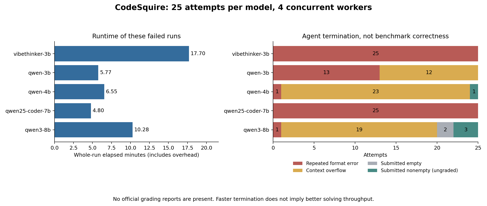

**CodeSquire overnight run audit — October 10, 2026.**

The five saved runs are useful as an integration diagnostic, but they do not establish a SWE-bench accuracy ranking. They contain **25 tasks per model, 125 attempts total**, not 20 tasks per model. All five runner processes returned exit code 1. No official grading report is present. There are four nonempty submissions, and one of those is a syntactically corrupt patch.

My provisional choice for a **direct GRPO pilot is Qwen/Qwen3-8B**, if the available training hardware supports it: it has the best demonstrated interaction reliability and the only clearly plausible repair in this batch. **Qwen/Qwen3-4B-Instruct-2507 is the leading smaller, cheaper challenger**, and could become the better choice after a repaired evaluation. Neither recommendation is an experimentally established training winner. First fix the rollout/grading pipeline and verify positive rewards on SWE-smith; this batch does not yet demonstrate a usable GRPO reward distribution.

The report separates recorded facts, static patch inspection, and recommendations. It does not assign invented test results to ungraded submissions.



**Evidence and reproducibility.** I parsed every trajectory and prediction, reconciled instance IDs and submissions, read every run status and the runner/configuration code, inspected the six submitted trajectories, and checked the four nonempty patch strings with read-only `git apply --numstat`. This checks diff syntax, not application to the correct repository or test correctness. Supporting data: [metrics.json](metrics.json), [125-row task table](tasks.csv), [per-task outcome matrix](task_matrix.md), and [PDF chart](comparison.pdf). Reproduce the audit from the repository root:

```text
python scripts/analyze_runs.py --output reports/20261010 --plot
```

The analyzer uses Python's standard library and Git; `--plot` additionally uses matplotlib. It does not execute commands from trajectories. Raw experiment artifacts and the evaluation/training configuration were not modified. Official tests were not rerun: this checkout has neither `swebench` nor `modal` installed in its available Python interpreter, and the original remote grading console logs are absent. Before preparing the PR, I also inspected the orchestration log and two grading `run.json` metadata files added to upstream main at `cfb491b`. They confirm grading initialization, but contain no grades or underlying grading error.

**What was actually run.** The five model identities are recorded in their `overnight-status.json` files:

| Run alias | Checkpoint |
|---|---|
| vibethinker-3b | WeiboAI/VibeThinker-3B |
| qwen-3b | Qwen/Qwen2.5-3B-Instruct |
| qwen-4b | Qwen/Qwen3-4B-Instruct-2507 |
| qwen25-coder-7b | Qwen/Qwen2.5-Coder-7B-Instruct |
| qwen3-8b | Qwen/Qwen3-8B |

`models.yaml` also lists DeepSeek-Coder-6.7B, but there is no corresponding saved run to assess. All five runs use the same selected IDs, four inference workers, Modal execution, mini-SWE-agent 2.4.6, temperature 0, 2,048 maximum output tokens per request, a 30-step agent limit, and three consecutive format errors before termination. Their saved configurations are consistent within each model. API responses identify vLLM 0.31.0 builds. The launcher uses FP16, an 8,192-token context, and the Hermes tool parser. The context cap is independently confirmed by saved API errors.

The 600-second timeout applies to each shell command and grading test execution, not an entire model evaluation. The saved agent wall-time limit is zero. None of the 125 attempts ended with a recorded step-limit or wall-time-limit exit; increasing the 30-step budget alone would not address the observed failures.

The [selection manifest](../../datasets/swebench_verified_validation_25.json) describes a deliberately balanced validation sample across 12 repositories: ten tasks labeled under 15 minutes, ten between 15 minutes and one hour, four between one and four hours, and one over four hours. Those are human difficulty labels. This is not a random sample representative of all Verified tasks, and one result changes its score by four percentage points. Repeatedly using it for model selection makes it validation data. The runner loads the live dataset; the manifest's recorded revision is not enforced by the execution path.

**Runtime comparison.** These are measured times for the actual failed runs, not estimates of a successful evaluation or GRPO training cost.

| Model | Whole run | Elapsed / 25 attempts | Calls, including failed requests | Saved completion tokens | Nonempty submissions |
|---|---:|---:|---:|---:|---:|
| VibeThinker-3B | 17m 42s | 42.48 s | 75 | 147,699 | 0/25 |
| Qwen2.5-3B-Instruct | 5m 46s | 13.84 s | 222 | 83,244 | 0/25 |
| Qwen3-4B-Instruct-2507 | 6m 33s | 15.72 s | 285 | 49,462 | 1/25 |
| Qwen2.5-Coder-7B-Instruct | 4m 48s | 11.52 s | 75 | 13,888 | 0/25 |
| Qwen3-8B | 10m 17s | 24.68 s | 275 | 78,973 | 3/25 |

The sum of logged durations is **45m 06s**. The batch spans 06:45:27–07:30:37 EDT on October 10, about 45m 10s including gaps. The Qwen3-8B rounded monotonic duration is one second longer than the difference between its second-resolution start/end timestamps; the table consistently uses `elapsed_seconds`.

`elapsed_seconds` starts before model-server startup and includes loading/downloads if needed, readiness checks, the optional tool probe, inference, any attempted grading, server shutdown, and a three-second cleanup sleep. It is recorded before publishing to Git. Since four tasks run concurrently, elapsed/25 is an **amortized batch cost**, not average task latency. The individual server and runner logs are still absent, preventing a precise breakdown of decoding, sandbox startup, and grading. GPU type, utilization and actual training memory requirements are not recorded.

The subsequently uploaded [orchestration log](../../overnight.log) does distinguish time before launching the runner from time spent inside it. These second-resolution intervals include polling and other orchestration overhead:

| Model | Startup/readiness/probe before runner launch | Runner launch to reported failure |
|---|---:|---:|
| VibeThinker-3B | 168 s | 890 s |
| Qwen2.5-3B-Instruct | 46 s | 296 s |
| Qwen3-4B-Instruct-2507 | 127 s | 262 s |
| Qwen2.5-Coder-7B-Instruct | 133 s | 152 s |
| Qwen3-8B | 159 s | 454 s |

The runner interval combines inference, validation and any attempted grading; it is not pure model generation time. Shutdown/cleanup explains most of the remainder relative to whole-run elapsed time.

Some timestamps survive inside trajectories, allowing a narrower timing proxy:

| Model | Window from first to last recorded response/tool event | Median per-task recorded span | 90th percentile span |
|---|---:|---:|---:|
| VibeThinker-3B | 793.0 s | 27.0 s | 27.0 s |
| Qwen2.5-3B-Instruct | 278.3 s | 15.9 s | 49.6 s |
| Qwen3-4B-Instruct-2507 | 242.3 s | 14.4 s | 44.0 s |
| Qwen2.5-Coder-7B-Instruct | 130.0 s | 4.0 s | 9.0 s |
| Qwen3-8B | 430.0 s | 47.9 s | 70.1 s |

These spans omit initial sandbox setup and unrecorded terminal work. Format-error responses often have only the API's second-resolution `created` timestamp, without a completion timestamp; for error-only trajectories the final generation duration is therefore omitted. Do not treat these spans as complete task latency or token-generation speed. They support the broad observation that Qwen3-8B spent more time interacting, while Coder-7B terminated almost immediately.

The Coder-7B run is fastest because it never gets past tool formatting. VibeThinker spends the most time generating long responses without executing a command. Increasing context and fixing tool use will likely lengthen rollouts while making them useful; these runtimes should not be extrapolated to productive training.

**Failure distribution and interaction quality.**

| Model | Context overflow | Repeated format error | Submitted empty | Submitted nonempty | Tasks with a tool observation |
|---|---:|---:|---:|---:|---:|
| VibeThinker-3B | 0 | 25 | 0 | 0 | 0/25 |
| Qwen2.5-3B-Instruct | 12 | 13 | 0 | 0 | 17/25 |
| Qwen3-4B-Instruct-2507 | 23 | 1 | 0 | 1 | 25/25 |
| Qwen2.5-Coder-7B-Instruct | 0 | 25 | 0 | 0 | 0/25 |
| Qwen3-8B | 19 | 1 | 2 | 3 | 24/25 |
| Total | 54 | 65 | 2 | 4 | 66/125 |

Thus, 119/125 attempts stop on context or format errors, and 121/125 final prediction strings are empty. `Submitted` means the agent emitted the submission sentinel; it is not a correctness grade.

| Model | Accepted action-bearing responses / saved responses | Format-error responses | Tool observations | Nonzero shell results | Output tokens in rejected responses |
|---|---:|---:|---:|---:|---:|
| VibeThinker-3B | 0/75 (0%) | 75 | 0 | — | 100% |
| Qwen2.5-3B-Instruct | 138/210 (65.7%) | 72 | 149 | 84/149 (56.4%) | 68.6% |
| Qwen3-4B-Instruct-2507 | 205/262 (78.2%) | 57 | 204 | 35/204 (17.2%) | 30.8% |
| Qwen2.5-Coder-7B-Instruct | 0/75 (0%) | 75 | 0 | — | 100% |
| Qwen3-8B | 243/256 (94.9%) | 13 | 239 | 99/239 (41.4%) | 21.2% |

Accepted responses can contain multiple commands. Submission commands terminate the agent without a normal tool-observation message, explaining some count differences. A nonzero shell status does not automatically mean a coding failure: `grep` returns 1 when nothing matches. These figures measure interaction behavior, not test pass rates.

Across all runs, 250,657 of 373,266 saved completion tokens—**67.2%**—belong to responses rejected for formatting. That is a concrete optimization target. The 932 API-call count exceeds the 878 saved responses by exactly 54, matching the 54 context-limit failures. Prompt token totals count repeated context on successive calls; neither those totals nor completion counts are a GPU billing measurement.

**Why the context limit causes so much damage.** With an 8,192-token context and a requested 2,048-token completion, the prompt must fit within approximately 6,144 tokens. A saved error explicitly rejects a prompt of at least 6,145 tokens. The budget includes the issue, system instructions, tool definitions, conversation history and command outputs—not just the latest file being read.

The instruction template is long, and the observation template allows up to 10,000 characters of a command's output, then retains head and tail if it is larger. Repeated searches and whole-file reads quickly fill the remaining capacity. One Qwen3-8B Django trajectory receives 34,247 raw output characters before overflowing; the model sees a truncated version, but that still consumes substantial context. Qwen3-4B's 23 context failures show that it is primarily blocked by this setup after it starts working.

The benchmark runner records an empty submission on an uncaught exception; it does not automatically harvest a useful partial worktree diff after context failure. Consequently, an empty prediction does not prove that the model never tried editing. The pinned [mini-SWE-agent benchmark implementation](https://raw.githubusercontent.com/SWE-agent/mini-swe-agent/v2.4.6/src/minisweagent/run/benchmarks/swebench.py) confirms the exception-to-empty-submission path.

**Why tool formatting fails.** The agent requires native `bash` tool calls. Writing a fenced shell command or tool-shaped JSON inside ordinary assistant text is not an executed action. Rejected model responses are saved under a corrective user message's `extra.response`, so inspecting only assistant-role messages misses much of what the failing models generated.

The startup probe explicitly uses `tool_choice="required"`; the actual saved rollout `model_kwargs` do not. The probe therefore checks a different request mode and is only advisory when it fails. It cannot certify the real agent loop. The separate `eval.py` script contains a required-tool override, but the overnight path uses `scripts/overnight_eval.py` and `scripts/remote_eval.sh` with `configs/qwen.yaml`.

A strong next diagnostic is to use the same model, template, prompt, tool schema and tool-choice setting in both probe and rollout, then require several successful observe–act turns. Test required or named `bash` calls, and consider one command per turn during debugging. vLLM documents required/named function calling and Hermes support for Qwen2.5; this makes a blanket assertion that “Hermes is wrong for Qwen2.5” unjustified. Validate behavior against the installed version. Constraining the schema cannot make the chosen commands correct. [vLLM tool-calling documentation](https://docs.vllm.ai/en/latest/features/tool_calling/).

**Assessment of VibeThinker-3B.** Every task ends after three format errors: 75 model responses, no accepted actions, no shell observations and no patch. Of its 75 responses, 59 hit the 2,048-token output limit. It generates 147,699 tokens, more than any other candidate, without producing an executable interaction. This is a poor starting point for direct sparse-reward agent GRPO under this interface. The current [official model card](https://huggingface.co/WeiboAI/VibeThinker-3B) explicitly says it was not trained on tool-calling or agent-based programming data and discourages those uses. Competitive-programming reasoning strength would not resolve this protocol mismatch by itself. Reconsider only if acquiring tool-use behavior through supervised training is part of the research objective.

**Assessment of Qwen2.5-3B-Instruct.** It does execute commands on 17 tasks, but produces no submission. Its 13 format exits and 12 context exits combine interface weakness with the shared budget problem. Some outputs contain fabricated conversational turns or placeholder paths; the Astropy-14369 trajectory initially tries `src/astropy/table/Table.py`, which does not exist. It is a possible very-small-model research baseline, but there is no positive repair evidence here to prefer it over Qwen3-4B. If 3B is a hard resource constraint, repair the interface and consider an SFT warm start before GRPO.

**Assessment of Qwen3-4B-Instruct-2507.** It obtains tool observations on all 25 tasks and uses fewer completion tokens than the other models that meaningfully interact. Its low nonzero-command fraction and concise generation make it attractive for a limited-compute pilot. However, 57 responses are rejected, including 17 attempts to invoke an unavailable `find` tool instead of running `find` through `bash`. It has 23 context exits. Its only submission is hand-written patch text for Astropy-7336 rather than a diff of an edited source file, and the saved patch fails syntax inspection. This is encouraging interaction efficiency, not evidence of a solved task. The [official model card](https://huggingface.co/Qwen/Qwen3-4B-Instruct-2507) identifies it as a non-thinking 4B model with a context capacity much larger than the launcher's 8K cap. That supports testing a larger serving context if memory permits; it does not establish the best training sequence length.

**Assessment of Qwen2.5-Coder-7B-Instruct.** All 25 tasks fail after exactly three format errors. The 75 outputs end normally rather than reaching the output limit, but none becomes a tool call. For example, the Astropy trajectory writes fenced commands to create and run a reproduction without executing either. This run has tested tool-protocol compatibility much more than repository-repair ability. It would be premature to conclude that this checkpoint cannot code. Re-run it after fixing the request/template contract, or use an agent-compatible SFT warm start; it is not currently a demonstrated direct-GRPO choice.

**Assessment of Qwen3-8B.** It has the best accepted-response rate, 94.9%, with only 13 rejected responses. It submits on five tasks, but two submissions are empty. Three patches have valid diff syntax; only the SymPy patch is clearly promising on inspection. There are still 19 context failures and many failed shell commands. Its 78,973 completion tokens are about 1.60 times Qwen3-4B's, and its whole-run duration is about 1.57 times as long, though the runs have different terminal behavior and unknown overhead.

The saved responses include thinking text. Qwen3-8B defaults to thinking mode; its model card advises against greedy decoding in that mode and documents `enable_thinking=False`. The temperature-zero run is therefore not an evaluation under its recommended thinking sampling settings. Compare explicit thinking and non-thinking configurations under realistic budgets rather than silently mixing modes. [Qwen3-8B model card](https://huggingface.co/Qwen/Qwen3-8B).

**Inspection of every submission.** These conclusions are static assessments, not official grades.

| Model and task | Evidence | Assessment |
|---|---|---|
| Qwen3-4B: astropy-7336 | Writes patch text with `echo -e`; saved output starts `-e diff --git`; hunk counts are inconsistent. `git apply --numstat` reports `corrupt patch at line 15`. | Malformed artifact as saved; not a validated repair. |
| Qwen3-8B: astropy-7336 | Creates a reproduction with an initially missing import, then encounters a NumPy import failure; never edits the intended source. | Submits an empty diff. |
| Qwen3-8B: django-15863 | Replaces `Decimal(str(float(text)))` with `Decimal(str(Decimal(text)))` inside an exception fallback. No reproduction or test is executed after the edit. | Valid diff syntax, but likely misses the reported precision-loss path; inspect and grade before claiming a fix. |
| Qwen3-8B: requests-1142 | Writes proposed function text into `patch.txt`, never updates `requests/models.py`, then overwrites `patch.txt` with an empty `git diff`. | Empty submission caused by an editing/submission workflow error. |
| Qwen3-8B: scikit-learn-10297 | Broad `sed` inserts documentation prose inside six constructor signatures, plus a malformed argument insertion. | Valid diff syntax but visibly invalid Python; expected to fail import/tests. |
| Qwen3-8B: sympy-16886 | Edits the mapping from `"----": "1"` to `".----": "1"`, creates a real Git diff, inspects it and submits separately. | Matches the stated one-line bug and is the strongest candidate for reward 1; still ungraded. |

None of the four nonempty submissions is accompanied by a successful post-edit reproduction or test in its trajectory. The SymPy agent re-reads nearby code, which is not an executed correctness check. The Django agent also combines patch creation with submission despite the prompt asking for separate steps. The agent accepts that submission anyway; prompt instructions are not equivalent to programmatic validation.

**An additional environment issue.** Genuine Python import errors appear in two Qwen2.5-3B tasks and seven Qwen3-8B tasks. Examples include missing NumPy, pandas, matplotlib and Flask. The Astropy-7336 trace explicitly fails to import the installed dependencies. This may indicate an unactivated environment or the wrong interpreter rather than a missing benchmark image dependency. The artifacts do not establish which. Verify the interpreter, `PATH`, repository installation and image environment initialization before attributing these failures to the model. Text such as `except ImportError:` printed from source was excluded from these counts.

**Why there is no reward in the JSON.** There are several separate mechanisms:

1. `*.traj.json` records interaction, `info.exit_status`, `info.submission`, API responses and `info.model_stats`. `preds.json` stores patch submissions. Neither is a GRPO reward log. There is no reward-named key anywhere in the 125 trajectory objects.
2. `instance_cost: 0.0` is a cost-accounting value, not reward 0. Local serving and `cost_tracking: ignore_errors` do not measure your GPU or Modal bill.
3. For VibeThinker, Qwen2.5-3B and Coder-7B, [remote_eval.sh](../../scripts/remote_eval.sh) explicitly exits before grading when every patch is empty. Setting `mode: all` records intent, not completion.
4. Qwen3-4B and Qwen3-8B have nonempty patches and publication manifests listing an excluded `evaluation-console.log`. Their subsequently uploaded `logs/run_evaluation/<run_id>/run.json` files additionally confirm grading initialization at 11:15:25 UTC and 11:30:32 UTC respectively. Neither has `evaluation/results.json` or any per-task `report.json` in this checkout. The orchestration log records runner failure one and two seconds after those metadata timestamps, respectively, but does not expose the exception. Their exact grading failure cannot be recovered from the available files. Potential causes such as Modal failure, harness failure or incompatible report paths are hypotheses, not findings.
5. The wrapper leaves `error` as null when the child merely returns a nonzero exit code; it sets an error string for exceptions or its own timeout. Thus `error: null` alongside `runner_exit_code: 1` does not mean success.

Official SWE-bench results normally distinguish resolved, unresolved, empty patches and evaluation errors, with a per-instance `resolved` boolean. A training adapter can map a completed, valid grade to binary reward. Missing grades must remain missing. The [official reporting implementation](https://raw.githubusercontent.com/SWE-bench/SWE-bench/main/swebench/harness/reporting.py) shows these fields and its current `logs/run_evaluation/<run_id>/results.json` location. The installed harness version from the remote machine was not recorded, so do not assume its exact output contract matches today's source.

It is reasonable to count the empty submissions as unsuccessful attempts in this fixed evaluation. It is **not** reasonable to present the absent reports as a measured 0% official score for all five models. Nor does 3/25 nonempty submissions mean 12% resolved for Qwen3-8B. No official positive reward is available in the checkout, but that is different from proving that no patch could earn one.

**The GRPO choice and what would change it.** If choosing a model today for a direct GRPO feasibility pilot, I would start with **Qwen3-8B**, because sparse execution rewards require the model to reach meaningful actions and occasionally propose a correct repair. Its interaction reliability and SymPy submission are the best evidence of that prerequisite. I would compare it immediately against **Qwen3-4B-Instruct-2507** after fixing the shared pipeline. The 4B model has a smaller parameter footprint and less generated text here, which makes it a sensible limited-memory alternative, but its only patch is corrupt. These observations do not quantify full-training memory, throughput or final accuracy.

If the intended project includes supervised agent training before RL, Coder-7B remains a reasonable candidate to re-evaluate. SWE-smith's own training documentation describes generating successful expert trajectories and supervised fine-tuning; the published recipe is not evidence that plain GRPO on an initially failing agent will work. [SWE-smith training guide](https://swesmith.com/guides/train_swe_agent/). VibeThinker is the least attractive direct-GRPO candidate in this batch because both the observed behavior and its documented training scope indicate a substantial interface gap.

The decision criterion should be **reliable reward-bearing rollouts and mixed-reward groups per unit of compute**, followed by held-out repair performance. The fastest failing model and the model producing the most text are both poor proxies. Hardware availability and whether you plan full fine-tuning or adapters remain unspecified; there is no defensible universal GPU-memory prescription from these logs.

**Why an all-zero reward batch will not teach the desired behavior.** In ordinary outcome-based GRPO, a rollout's advantage depends on its reward relative to the other rollouts for the same problem, commonly `(reward - group_mean) / (group_std + epsilon)`. If every member receives the same reward, the centered task-reward advantage is zero. Other terms such as a KL penalty may still update parameters, but they do not supply the missing success signal. [TRL GRPO documentation](https://huggingface.co/docs/trl/grpo_trainer).

This evaluation uses one temperature-zero attempt per task, so it does not measure the grouped reward diversity needed for GRPO. For illustration, with independent binary success probability `p` and eight rollouts, the probability of a mixed group is `1 - p^8 - (1-p)^8`: about 7.7% at p=1%, 33.7% at p=5%, and 57.0% at p=10%. These are mathematical examples, not estimates from this batch; real samples can be correlated. Start on tasks where the policy sometimes succeeds, use nonzero sampling temperature, and track the fraction of groups with nonzero reward variance.

**A concrete next experiment.**

1. Recover the two original grading console logs and any remote `logs/run_evaluation` artifacts. Save a sanitized failure summary and relevant logs even when the grader fails. Record stage statuses separately: startup, inference, grading and publication. Preserve partial grading reports in an error/finally path. The shell's current `set -euo pipefail` can exit before report copying if the harness fails.
2. Validate grading independently of a model. Use a known-correct patch and an empty patch on a small task, verify expected outcomes, and record the installed harness version. The existing local `run_swebench.sh gold` path uses its own environment requirements; it is not a drop-in replacement for the remote Modal runner. For the original 8B predictions, grading can be rerun on the configured Linux/Modal host without loading the LLM, using the command below.
3. Align the real tool-call contract with its probe. Make probe failure stop that model's batch, and test a multi-turn read/edit/diff sequence. Try required/named `bash` tool calls; log the effective request parameters. Do not increase the format-error retry budget as the first fix.
4. Give working agents enough context. Test 16K or 32K serving context if supported by the checkpoint and available memory, enforce token-aware observation/history budgets, and avoid whole-file output. Check available input room before generation. Reducing output tokens alone trades context overflow for truncated thinking. Increasing step count alone is ineffective here.
5. Verify the task Python environment on a small selection of repository images, including an affected Astropy or scientific-Python task. Confirm imports and test execution under the same shell used by the agent. Prefer a known working interpreter/environment over ad hoc package installation during every rollout.
6. Validate submission artifacts before grading: obtain the diff from actual edited files, check it against a clean base, and run an appropriate syntax/reproduction check. If you add partial-diff recovery after an agent crash, label it separately and rerun all models under the same policy; changing submission extraction changes the evaluated agent.
7. Run a small SWE-smith feasibility sample with Qwen3-8B and Qwen3-4B, for example 20–50 validated tasks with 4–8 stochastic rollouts each. Those sizes are proposed pilot settings, not optimized hyperparameters. Measure valid tool calls, applied patches, completed grades, binary rewards, mixed-reward group rate, tokens, task wall time and sandbox/grader overhead. Expand only once reward and environment behavior are reliable.
8. If almost all groups still fail, use easier tasks and/or a compact SFT warm start on successful agent trajectories in the same interaction format. Then run GRPO and compare held-out performance against the untrained baseline. Keep these 25 Verified tasks for validation and reserve a separate final evaluation set.

Example grading-only retry on the original configured host, with a fresh run ID:

```bash
bash scripts/remote_eval.sh evaluate \
  --output runs/20261010T104527Z_qwen3-8b \
  --ids runs/20261010T104527Z_qwen3-8b/selected_ids.txt \
  --run-id audit_qwen3_8b_grade_01 \
  --python .venv-swebench/bin/python
```

Retain the full command output even if this retry fails. Inspect the script's expected report location against the installed harness. There is no need to regenerate the already-saved predictions to recover their grades.

**Implementing a trustworthy SWE-smith reward.** SWE-smith needs its own instance setup and evaluator, not simply a different dataset name passed to the Verified runner. The Python dataset provides `image_name`, bug-instance IDs and test sets. Its task `patch` is the change that **introduces** the bug; a model prediction is the repair. The official harness checks out the bug instance and handles gold evaluation specially. Getting this direction wrong can silently train against the wrong repository state. [SWE-smith validation/evaluation guide](https://swesmith.com/guides/harnesses/), [official evaluation source](https://raw.githubusercontent.com/SWE-bench/SWE-smith/main/swesmith/harness/eval.py), [SWE-smith-py dataset](https://huggingface.co/datasets/SWE-bench/SWE-smith-py).

Use a clean bug environment for every rollout, apply the candidate repair, execute the prescribed evaluator tests, and record both test outcomes and operational status. For a valid completed evaluation, start with reward 1 only when the issue's failing tests are repaired and required regression tests remain passing; otherwise reward 0. A missing report, broken image or unavailable grader should be retried or excluded from the optimization batch under an explicit policy, not silently turned into a negative reward. Agent-caused invalid patches and genuine task failures are different from infrastructure failures. Keep all attempts visible in evaluation accounting even when infrastructure-invalid examples are excluded from training.

Persist explicit records such as `instance_id`, `rollout_id`, `agent_exit_status`, `patch_present`, `patch_apply_status`, `grading_status`, `resolved`, `reward`, token usage, elapsed time and error details. Use null for unknown reward. Do not infer correctness from the agent's own statement that tests passed. Partial test credit is an optional later experiment, not a substitute for first establishing a correct binary evaluator; account for regression failures and avoid easy-to-game rewards for patch length or tool-call count.

For GRPO, compute the outcome reward for the whole rollout and optimize model-generated tokens, masking environment/tool observations and prompt tokens from the policy loss. Keep tokenizer, chat template, thinking mode and tool serialization consistent between training and rollout serving. Preserve a separate SWE-smith validation split and check for task/patch overlap with evaluation data.

The immediate project milestone is therefore a reproducible path from a repair rollout to a trustworthy grade. This audit already identifies where most current compute is lost, gives Qwen3-8B a provisional lead for a direct pilot, and identifies Qwen3-4B as the efficiency candidate worth testing before committing the training budget.
